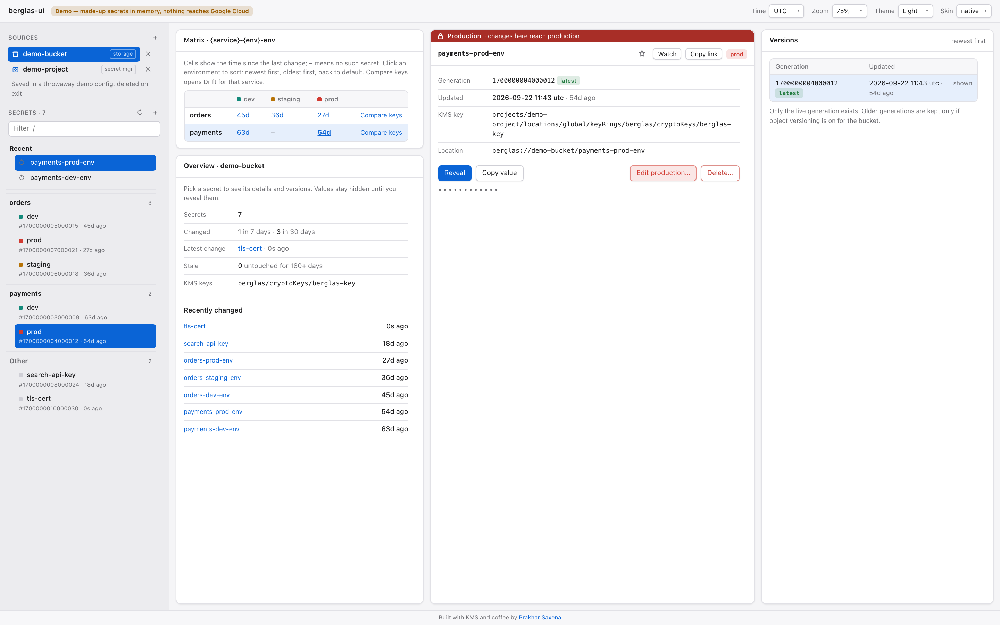
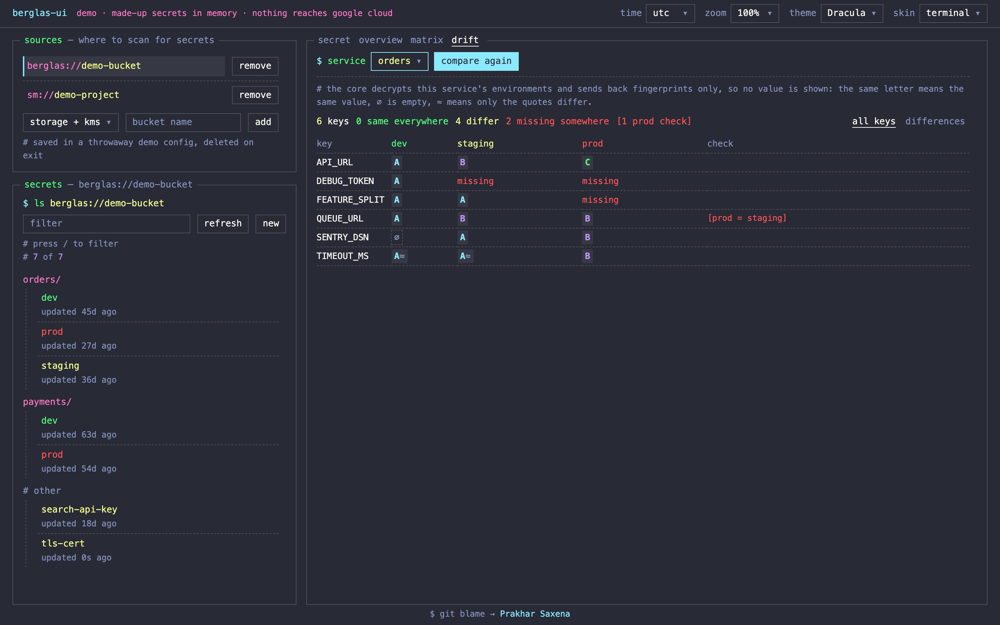
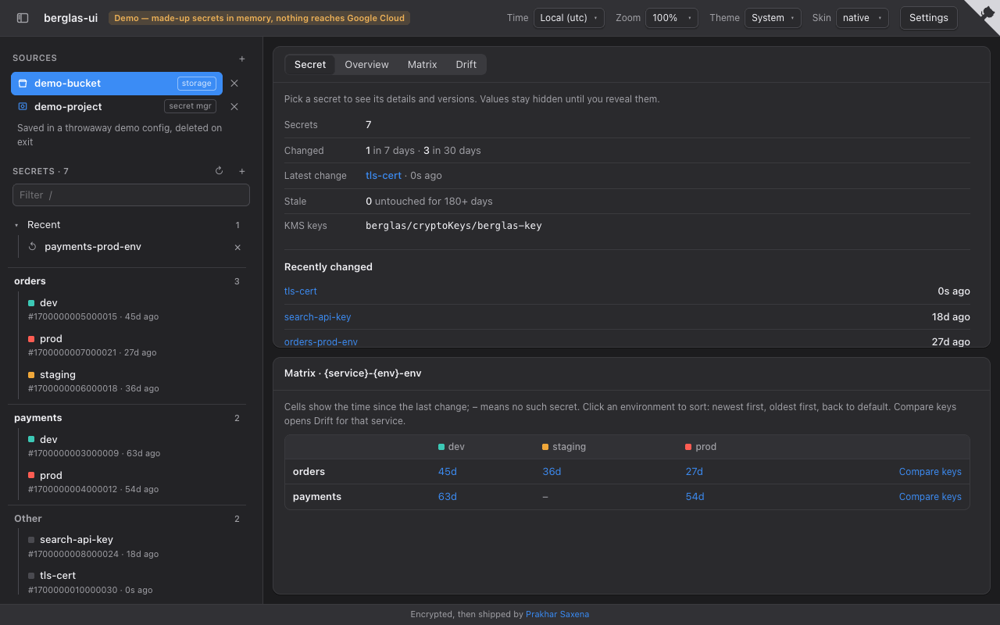
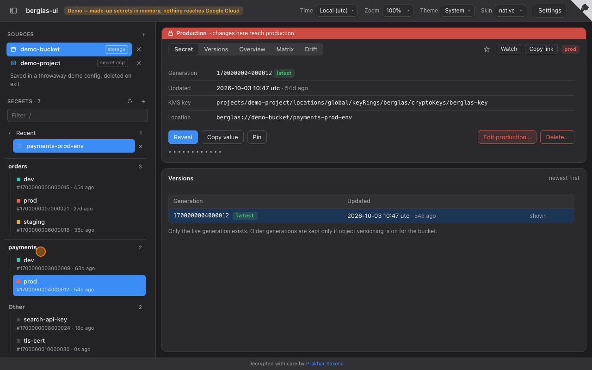
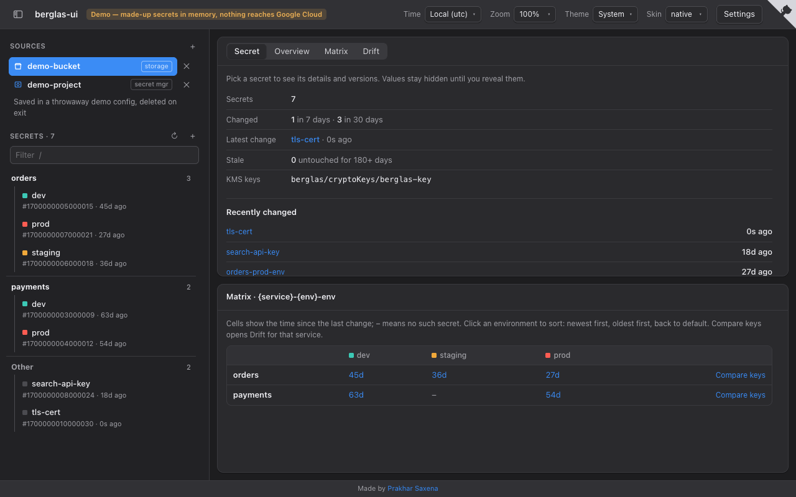
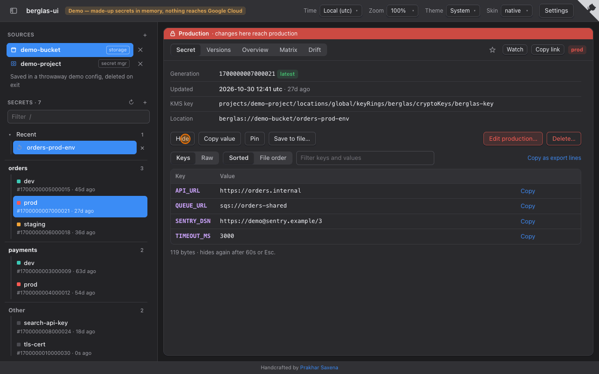
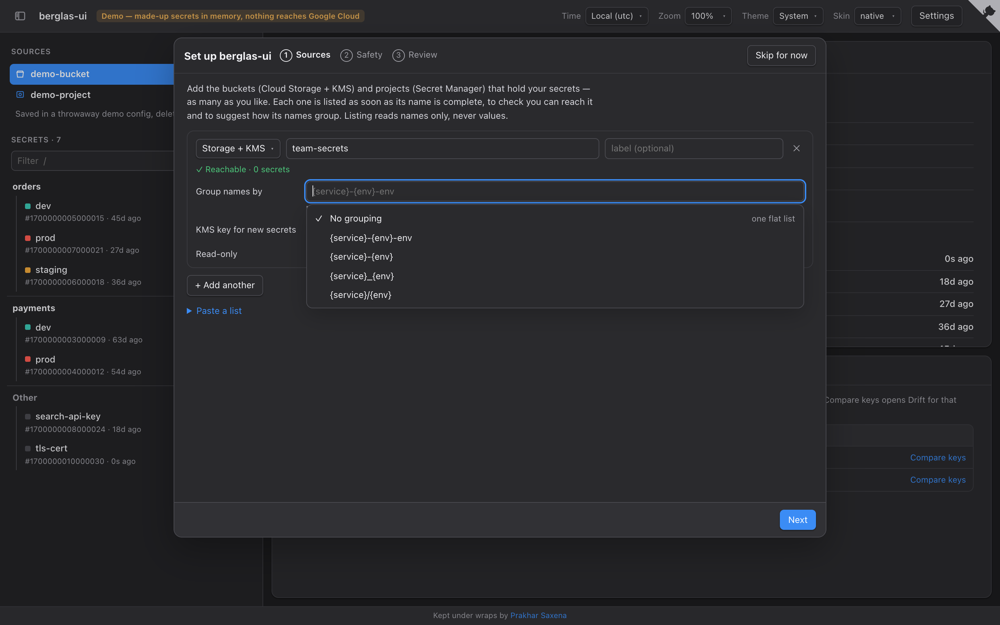

# berglas-ui

An unofficial desktop and web UI for [berglas](https://github.com/GoogleCloudPlatform/berglas)
secrets, on both of its backends: Cloud Storage + KMS (`berglas://`) and Secret Manager (`sm://`).
Browse, read, compare and change your team's secrets, with guard rails that make mistakes hard.

> Not an official Google project, and not affiliated with or endorsed by Google.

<p>
  
  
</p>

## Features

- **One window for all your secrets**: buckets (Storage + KMS) and projects (Secret Manager),
  grouped by service, with dev / staging / prod in their own colours
- **Hidden until you ask**: reveal a value with a click; it hides itself again, and copies are
  wiped from the clipboard
- **`.env` secrets as a table**: filter keys and values, copy one key, or copy them all as shell
  `export` lines
- **Edit with a review step**: change keys one by one or paste `KEY=value` lines, see exactly what
  will change, and nothing is written until you save
- **Never overwrite a teammate**: a save is refused if someone saved in between
- **Versions**: view, diff and restore any earlier version
- **Compare environments**: a service × environment matrix, and key drift that shows which keys
  are missing or differ, without ever showing a value
- **Pin and compare**: keep one secret open and compare others against it
- **Protected names**: saving or deleting `*-prod-*` (or any pattern you pick) needs the word
  `confirm` typed
- **Fast to get around**: ⌘K command palette, favourites, recents, watch a secret for changes
- **Mac app**: native menus, Touch ID lock, hidden from screenshots and screen sharing
- **Two looks**: native and terminal skins, with themes including the four Catppuccin flavours

## Built to keep secrets secret

**It runs on your computer and talks only to Google Cloud.** There's no berglas-ui account, no
server in between, no analytics and no telemetry. It signs in with your own Google login, so
it can see and change exactly what your account already can, and nothing more. Secrets are read
and written by Google's own [berglas](https://github.com/GoogleCloudPlatform/berglas) library.

**Values stay out of sight.**
- Nothing is shown until you click **Reveal**, and it hides again on its own after a minute.
- Anything you copy is wiped from the clipboard after 30 seconds.
- Comparing environments never puts a value on screen: the app compares fingerprints of the
  values instead.
- Values are never written to logs.

**Mistakes are hard to make.**
- Every change shows you exactly what will be saved before anything is written.
- Production secrets sit under a red banner.
- Names you protect (say `*-prod-*`) need the word `confirm` typed before a save or delete.
- A save never overwrites a change a teammate made in the meantime.
- An optional audit log keeps a record of every change, without the values.

**The mac app goes further.**
- It opens no network port at all: the window and the app run as one program, so nothing else
  on your Mac can talk to it.
- It stays out of screenshots, recordings and screen sharing.
- It can lock itself when you step away; Touch ID unlocks it.

The details, including the known limits, are in **[SECURITY.md](SECURITY.md)**.

## See it in action

**Reveal a secret, filter its keys, copy one**



**Edit, review the change, save**



**Jump with ⌘K, then compare a service across environments**



**Switch skins and themes**



## Getting started

1. **Sign in to Google once** (berglas-ui uses your own login, so you only see what your
   account can see):

   ```bash
   gcloud auth application-default login
   ```

2. **Build and open it.** There are no published builds yet; you need Go and Node.

   ```bash
   scripts/build-mac.sh && open dist/berglas-ui.app        # the mac app
   ```

   or, in a browser on any platform:

   ```bash
   npm --prefix ui install && npm --prefix ui run build
   cd core && go run ./cmd/berglas-ui -open
   ```

3. **Add your sources.** On first run a setup guide asks for your buckets and projects, checks
   each one is reachable, and suggests how their names group and which ones to protect.



**Want to look around first?** Demo mode fills the app with made-up secrets; nothing reaches
Google Cloud:

```bash
cd core && go run ./cmd/berglas-ui -demo -open
```

## Learn more

- **[User guide](docs/GUIDE.md)**: everything the app does, in plain language: editing,
  comparing, versions, settings, shortcuts and troubleshooting
- **[Reference](docs/REFERENCE.md)**: install, credentials, the config file, building the mac
  app, the security model and the API
- **[Security](SECURITY.md)**: how the app protects your secrets, and how to report a
  vulnerability

## License

[Apache License 2.0](LICENSE)
